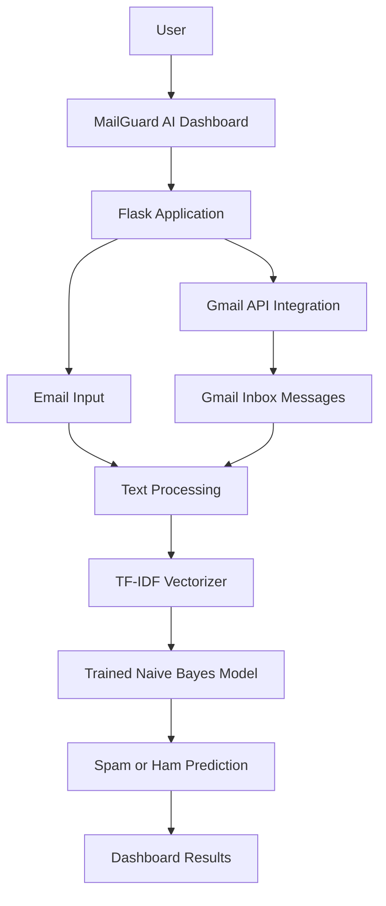
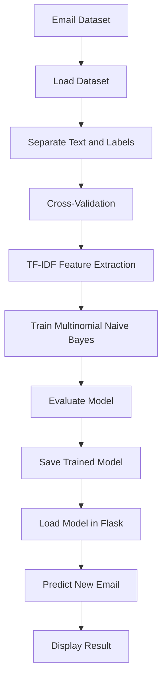
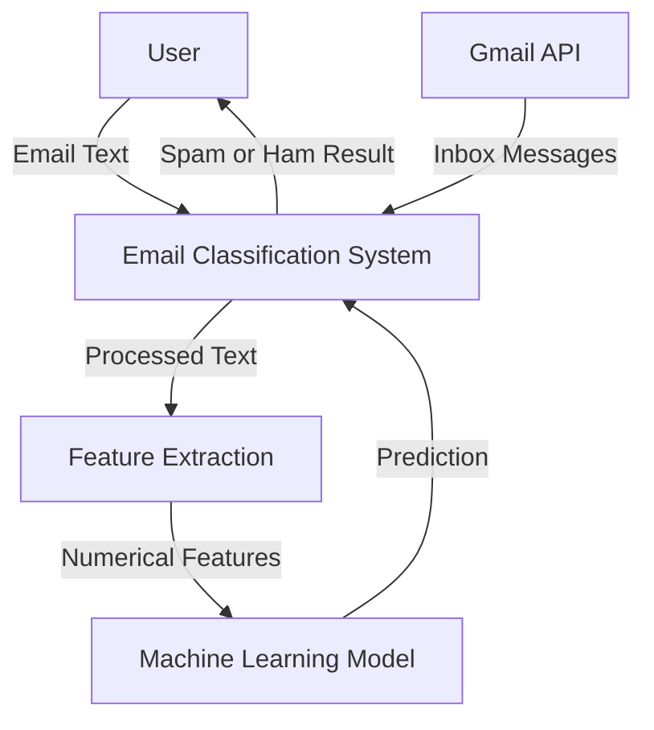
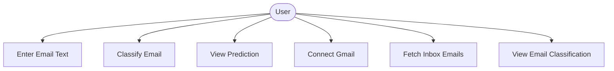
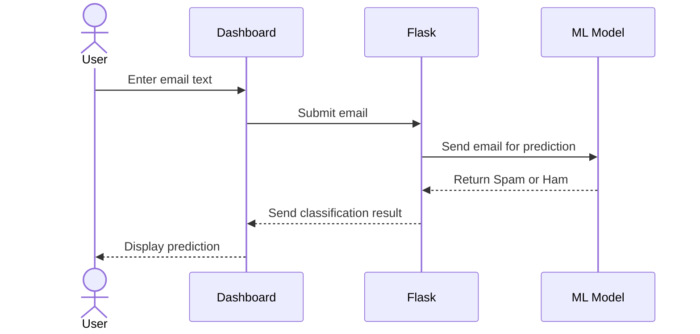
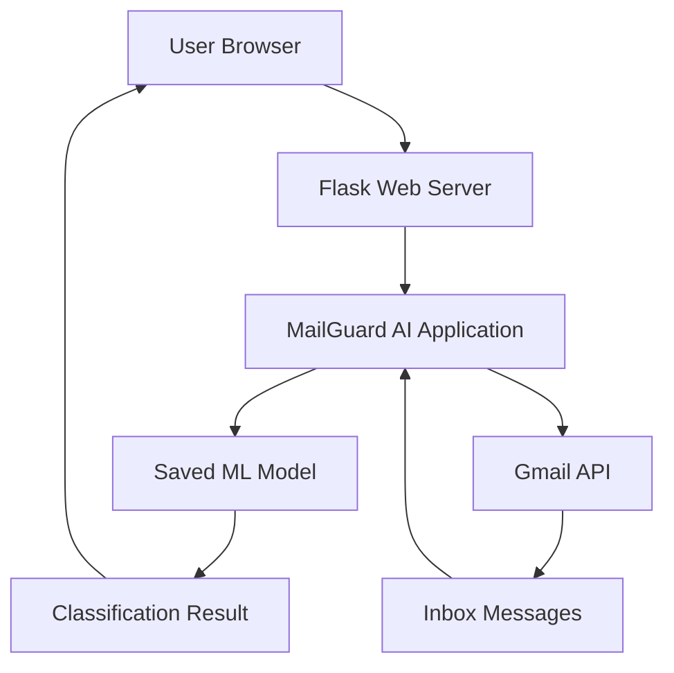

# MAILGUARD AI
## Intelligent Spam Email Detection and Security Dashboard

---

# PROJECT REPORT

**Project Title:** MailGuard AI – Intelligent Spam Email Detection and Security Dashboard

**Submitted by:**  
**Name:** Priyal Prasad Deshmukh  
**Roll Number:** CS3125

**Department:** Computer Science and Engineering  
**Institution:** CSMSS, CS COE  
**Academic Year:** 2026–2027

---

# ABSTRACT

MailGuard AI is a machine-learning-based email security application developed to identify and classify unwanted spam emails. The project aims to provide a simple and user-friendly platform through which email content can be analysed and classified as either Spam or Ham (legitimate email).

The system uses Natural Language Processing (NLP) techniques to convert textual email content into numerical features. TF-IDF (Term Frequency–Inverse Document Frequency) is used for feature extraction, while the Multinomial Naive Bayes algorithm is used for classification. The trained machine-learning model is integrated into a Flask web application that provides an interactive dashboard for users.

The application also includes Gmail integration through the Gmail API and OAuth 2.0 authentication. This feature allows users to connect their Gmail account and retrieve inbox messages for classification. The dashboard displays email information along with the predicted classification.

The model was evaluated using 5-fold stratified cross-validation on a dataset containing 2,796 emails. It achieved an accuracy of **98.32%**, with precision, recall, and F1-score of approximately **0.98** for both Spam and Ham classes.

MailGuard AI demonstrates how machine learning and web technologies can be combined to develop a practical email security solution. The project provides a foundation for further improvements such as advanced classification techniques, phishing detection, and real-time email monitoring.

---

# 1. INTRODUCTION

## 1.1 Background

Email is one of the most widely used methods of digital communication. It is used for personal communication, education, business activities, and sharing important information.

However, email platforms are frequently affected by unwanted messages known as spam emails. These messages may contain advertisements, misleading information, suspicious links, or potentially harmful content.

Manually identifying spam emails can be time-consuming. Therefore, automated spam detection systems are useful for analysing email content and identifying unwanted messages.

Machine learning provides techniques that can learn patterns from previously labelled data and use those patterns to classify new messages.

MailGuard AI applies machine-learning and natural language processing techniques to email spam detection through a web-based dashboard.

## 1.2 Problem Statement

The increasing number of unwanted emails creates difficulties for users who need to identify legitimate messages from spam messages.

Manual identification requires users to examine email content individually. This process can be inefficient, particularly when the number of incoming emails is large.

The project addresses this problem by developing an automated system that analyses email text and predicts whether the message is Spam or Ham.

## 1.3 Objectives

The main objectives of MailGuard AI are:

1. To develop a machine-learning-based email spam detection system.
2. To preprocess email text for classification.
3. To extract textual features using TF-IDF.
4. To train a Multinomial Naive Bayes classification model.
5. To develop a web interface using Flask.
6. To provide an interface for entering email text and viewing predictions.
7. To integrate Gmail using the Gmail API and OAuth 2.0 authentication.
8. To retrieve inbox messages and classify their content.
9. To display classification results through a user-friendly dashboard.

## 1.4 Scope of the Project

The scope of the project includes:

- Text-based spam and legitimate email classification.
- Machine-learning model training and prediction.
- Email text preprocessing and feature extraction.
- Flask-based web application development.
- Gmail account connection through OAuth 2.0.
- Retrieval and classification of inbox messages.
- Display of email details and classification results.

The current system focuses on classifying email text. It does not claim to provide complete protection against every type of phishing attack, malicious attachment, or email-based security threat.

## 1.5 Applications

MailGuard AI can be useful for:

- Identifying unwanted emails.
- Demonstrating automated email classification.
- Understanding practical applications of machine learning.
- Learning how NLP techniques work with textual data.
- Demonstrating Gmail API integration.
- Building a foundation for more advanced email security applications.

---

# 2. LITERATURE REVIEW / RELATED WORK

## 2.1 Existing Spam Detection Approaches

Email spam detection has been studied using several approaches, including rule-based filtering, keyword matching, blacklisting, and machine-learning algorithms.

Traditional systems often use predefined rules to identify unwanted messages. Such systems can be useful but may have difficulty identifying new spam patterns that do not match existing rules.

Machine-learning approaches use labelled examples to learn patterns from email content. These approaches can automatically classify messages based on the features extracted from the text.

## 2.2 Machine Learning in Spam Detection

Several machine-learning algorithms can be applied to text classification:

- Naive Bayes
- Support Vector Machines
- Logistic Regression
- Decision Trees
- Random Forest
- Neural Networks

Naive Bayes is commonly used for text classification because it is computationally efficient and works with numerical text features.

## 2.3 Natural Language Processing

Natural Language Processing enables computers to process and analyse human language.

In this project, email content is treated as textual data. The text is converted into numerical features so that the machine-learning algorithm can process it.

TF-IDF is used to represent the importance of words in a document relative to a collection of documents.

## 2.4 Limitations of Existing Approaches

Some limitations of basic spam detection approaches include:

1. Dependence on predefined filtering rules.
2. Difficulty identifying previously unseen spam patterns.
3. Limited flexibility when new types of unwanted messages appear.
4. Lack of a simple interface for testing email content.
5. Separation between email access and spam classification in basic demonstrations.

## 2.5 Proposed Approach

MailGuard AI combines text classification with a Flask-based dashboard.

The system uses TF-IDF for feature extraction and Multinomial Naive Bayes for classification. It also integrates Gmail through the Gmail API to retrieve inbox messages for classification.

This approach provides an accessible demonstration of machine-learning-based spam detection.

---

# 3. SYSTEM ANALYSIS

## 3.1 Existing System

Traditional email filtering systems may use predefined rules, sender information, keywords, and other filtering mechanisms to identify unwanted messages.

Although these techniques are useful, they may not always identify new or changing spam patterns.

## 3.2 Proposed System

The proposed MailGuard AI system uses machine learning to classify email content.

The system accepts email text from the user or retrieves messages through Gmail integration. The text is processed and passed to the trained model, which predicts whether the email is Spam or Ham.

The result is displayed through the Flask web dashboard.

## 3.3 Feasibility Study

### 3.3.1 Technical Feasibility

The project is technically feasible because it uses commonly available programming languages, libraries, and development tools.

The technologies used include:

- Python
- Flask
- Scikit-learn
- Pandas
- NumPy
- HTML
- CSS
- Gmail API
- OAuth 2.0

These technologies support machine-learning development and web application integration.

### 3.3.2 Operational Feasibility

The application provides a simple interface that allows users to enter email text and view classification results.

Gmail integration allows authenticated users to retrieve inbox messages for classification.

The system is designed to be understandable and easy to operate.

### 3.3.3 Financial Feasibility

The project primarily uses open-source programming languages and libraries.

The development can be performed using a personal computer and freely available development tools. Therefore, the software development cost is relatively low.

---

# 4. DATASET DETAILS

## 4.1 Dataset Overview

The dataset used in MailGuard AI contains email text and corresponding classification labels.

The dataset is prepared from email files stored in the `easy_ham_2` and `spam_2` folders. The preparation script extracts readable email content and assigns the corresponding Ham or Spam label.

The prepared dataset is stored in `dataset/emails.csv`.

The final dataset contains **2,796 email records**.

## 4.2 Dataset Attributes

The dataset contains the following main fields:

| Attribute | Description |
|---|---|
| text | Contains the email message content |
| label | Represents the category of the email |

The label identifies whether an email belongs to the Spam or Ham category.

## 4.3 Dataset Distribution

The dataset contains the following class distribution:

| Email Category | Number of Emails |
|---|---:|
| Ham | 1,400 |
| Spam | 1,396 |
| **Total** | **2,796** |

The dataset has a nearly balanced distribution between the two categories.

## 4.4 Data Preprocessing

Text preprocessing is an important step in preparing email content for machine learning.

The project uses TF-IDF vectorization with the following settings:

- Lowercase conversion enabled.
- English stop words removed.
- Maximum feature count set to 10,000.

These settings help convert email text into numerical features suitable for classification.

## 4.5 Training and Testing Approach

The model development process uses labelled email data to learn patterns for distinguishing Spam from Ham.

For model performance evaluation, **5-fold stratified cross-validation** was performed.

In this approach:

- The dataset is divided into five folds.
- Each fold is used once for validation while the remaining folds are used for training.
- Stratification helps maintain the class distribution across the folds.
- The results from all folds are combined to calculate the evaluation metrics.

This provides an estimate of the model's performance across different portions of the dataset.

---

# 5. SYSTEM DESIGN

## 5.1 System Architecture

The system consists of the following major components:

1. User Interface
2. Flask Application
3. Email Text Processing
4. TF-IDF Vectorizer
5. Trained Naive Bayes Model
6. Gmail API Integration
7. Classification Results Dashboard

### System Architecture Diagram



## 5.2 Machine Learning Pipeline

The machine-learning pipeline describes how email data is processed and classified.



## 5.3 Data Flow Diagram



## 5.4 Use Case Diagram



## 5.5 Sequence Diagram



---

# 6. MODEL DEVELOPMENT

## 6.1 Machine Learning Algorithm

The project uses the Multinomial Naive Bayes algorithm for email classification.

Naive Bayes is a probabilistic classification algorithm based on Bayes' theorem.

It calculates the probability of a class based on the features present in the input.

For text classification, Multinomial Naive Bayes is commonly used with numerical word-frequency or TF-IDF features.

## 6.2 TF-IDF Vectorization

TF-IDF stands for Term Frequency–Inverse Document Frequency.

It converts textual information into numerical values that represent the importance of words in a document.

Term Frequency measures how frequently a word appears in a document.

Inverse Document Frequency reduces the importance of words that appear frequently across many documents.

The TF-IDF representation helps the classification algorithm identify useful patterns in email content.

## 6.3 Multinomial Naive Bayes

The Multinomial Naive Bayes algorithm calculates the probability that an email belongs to a particular category.

The classification categories used in this project are:

- Spam
- Ham

The model learns from the training dataset and uses the learned patterns to classify new email messages.

## 6.4 Model Training

The model development process includes:

1. Loading the email dataset.
2. Separating email text and labels.
3. Preparing the data for model development.
4. Applying TF-IDF feature extraction.
5. Training the Multinomial Naive Bayes classifier.
6. Evaluating model performance.
7. Saving the trained model for use in the Flask application.

## 6.5 Model Saving

After training, the model is saved as a serialized file:

`models/spam_classifier.pkl`

The Flask application loads this saved model to perform predictions without retraining it every time the application starts.

The saved model is a Scikit-learn Pipeline containing:

- TF-IDF Vectorizer
- Multinomial Naive Bayes Classifier

This allows text processing and classification to be performed together.

---

# 7. IMPLEMENTATION

## 7.1 Technologies Used

| Technology | Purpose |
|---|---|
| Python | Main programming language |
| Flask | Web application framework |
| Scikit-learn | Machine-learning implementation |
| Pandas | Dataset handling |
| NumPy | Numerical operations |
| TF-IDF | Text feature extraction |
| Multinomial Naive Bayes | Email classification |
| HTML | Web page structure |
| CSS | Dashboard styling |
| Gmail API | Gmail inbox integration |
| OAuth 2.0 | User authentication |
| Git and GitHub | Version control and project hosting |

## 7.2 Hardware Requirements

The application can be developed and executed on a standard personal computer.

Minimum practical requirements include:

- A computer capable of running Python.
- Sufficient memory to load the dataset and trained model.
- Internet connectivity for Gmail API integration.
- A modern web browser.

The exact hardware configuration used during development can be added here if required.

## 7.3 Software Requirements

- Windows or another supported operating system.
- Python environment.
- Visual Studio Code or another code editor.
- Required Python libraries.
- Web browser.
- Gmail account for Gmail integration.

## 7.4 Flask Application

Flask is used to connect the machine-learning model with the web interface.

The application accepts email text through a web form, passes the text to the trained model, and displays the predicted category.

## 7.5 Gmail API Integration

MailGuard AI includes Gmail integration through the Gmail API.

OAuth 2.0 authentication is used to authorize access to the user's Gmail account.

After authorization, the application can retrieve inbox messages and process their content for spam classification.

The Gmail integration uses the read-only Gmail scope:

`https://www.googleapis.com/auth/gmail.readonly`

This scope allows the application to read email data without providing permission to modify or send emails.

## 7.6 Dashboard Interface

The dashboard provides an interface for users to interact with the application.

Its main functions include:

- Entering email text.
- Submitting email content for classification.
- Viewing Spam or Ham predictions.
- Connecting a Gmail account.
- Fetching inbox messages.
- Viewing email details and classification results.

---

# 8. TESTING AND EVALUATION

## 8.1 Testing Objectives

Testing is performed to verify that the application behaves as expected.

The main testing objectives are:

1. To verify that the Flask application starts successfully.
2. To check whether email text is accepted correctly.
3. To verify that the trained model loads successfully.
4. To check whether predictions are displayed correctly.
5. To verify Gmail authentication.
6. To check inbox message retrieval.
7. To verify classification of retrieved messages.

## 8.2 Functional Testing

| Test Case | Expected Result |
|---|---|
| Open the application | Dashboard should load |
| Enter email text | Text should be accepted |
| Submit email text | Model should generate a prediction |
| Classify a spam message | Spam result should be displayed when predicted |
| Classify a legitimate message | Ham result should be displayed when predicted |
| Connect Gmail | Authentication process should begin |
| Fetch inbox messages | Retrieved messages should be displayed |
| Classify fetched messages | Each processed message should display its predicted category |

## 8.3 Model Evaluation Metrics

The performance of MailGuard AI is evaluated using classification metrics.

### Accuracy

Accuracy measures the proportion of correctly classified emails out of all evaluated emails.

It provides an overall measure of the model's classification performance.

### Precision

Precision measures how many emails predicted as belonging to a particular class actually belong to that class.

For spam detection, it indicates how many emails predicted as Spam are actually Spam.

### Recall

Recall measures how many actual emails belonging to a particular class are correctly identified by the model.

For spam detection, it indicates how many actual Spam emails are successfully detected.

### F1-Score

F1-score is the harmonic mean of precision and recall.

It provides a combined measure of these two classification metrics.

### Confusion Matrix

A confusion matrix represents correct and incorrect predictions for each class.

The matrix contains:

- True Positive
- True Negative
- False Positive
- False Negative

These values help identify the types of classification errors made by the model.

## 8.4 Model Evaluation Results

The model was evaluated using **5-fold stratified cross-validation** on the complete dataset containing 2,796 emails.

The evaluation produced the following results:

### Overall Performance

| Evaluation Metric | Result |
|---|---:|
| Accuracy | **98.32%** |
| Total Emails Evaluated | 2,796 |

### Classification Report

| Class | Precision | Recall | F1-Score | Support |
|---|---:|---:|---:|---:|
| Ham | 0.98 | 0.98 | 0.98 | 1,400 |
| Spam | 0.98 | 0.98 | 0.98 | 1,396 |

The macro average and weighted average for precision, recall, and F1-score were also approximately 0.98.

### Confusion Matrix

The confusion matrix obtained during evaluation is:

| Actual / Predicted | Ham | Spam |
|---|---:|---:|
| Actual Ham | 1,379 | 21 |
| Actual Spam | 26 | 1,370 |

### Interpretation of Results

The confusion matrix shows that:

- 1,379 Ham emails were correctly classified as Ham.
- 21 Ham emails were incorrectly classified as Spam.
- 1,370 Spam emails were correctly classified as Spam.
- 26 Spam emails were incorrectly classified as Ham.

Therefore, the model correctly classified 2,749 out of 2,796 evaluated emails.

The overall accuracy of 98.32% indicates strong classification performance on the evaluated dataset.

The precision, recall, and F1-score values of approximately 0.98 for both classes indicate that the model performs consistently when identifying Spam and Ham emails.

**Note:** These values represent 5-fold stratified cross-validation results. They are evaluation estimates on the specified dataset and should not be interpreted as a guarantee of performance on every real-world email.

## 8.5 Cross-Validation and Further Analysis

5-fold stratified cross-validation was used to evaluate model performance across different portions of the dataset.

This approach helps assess how consistently the model performs when trained and evaluated on different folds.

Additional analysis, such as ROC curves and Precision-Recall curves, can be considered in future improvements to provide further information about classification performance.

---

# 9. RESULTS AND DISCUSSION

## 9.1 System Output

The application produces a classification result for the submitted email text.

The predicted categories are:

- **Spam:** The model identifies the message as spam.
- **Ham:** The model identifies the message as legitimate.

## 9.2 Model Performance Results

The model achieved an accuracy of **98.32%** during 5-fold stratified cross-validation.

The evaluation included 1,400 Ham emails and 1,396 Spam emails.

The model correctly classified:

- 1,379 Ham emails.
- 1,370 Spam emails.

A total of 47 emails were incorrectly classified during the evaluation.

These results demonstrate the model's ability to distinguish between Spam and Ham emails in the prepared dataset.

## 9.3 Dashboard Results

The Flask dashboard displays the classification result in a user-friendly format.

For Gmail integration, retrieved inbox messages are displayed with relevant email information and their predicted classifications.

## 9.4 Discussion

The project demonstrates the integration of machine learning, natural language processing, and web development.

TF-IDF converts email text into numerical features, while Multinomial Naive Bayes performs the classification.

Flask provides the application interface, and Gmail API integration extends the system to work with authenticated inbox messages.

The model evaluation produced an accuracy of 98.32%, with precision, recall, and F1-score values of approximately 0.98 for both Spam and Ham categories.

The confusion matrix provides further information about correctly and incorrectly classified emails.

The results indicate strong performance on the prepared dataset. However, actual performance on new emails may vary depending on the quality and diversity of the incoming messages.

## 9.5 Screenshots

Add actual screenshots of the working application in this section.

Suggested screenshots:

1. Main MailGuard AI dashboard.
2. Manual email classification.
3. Spam prediction result.
4. Ham prediction result.
5. Gmail authentication or connected state.
6. Retrieved Gmail inbox messages with classification results.

---

# 10. DEPLOYMENT

## 10.1 Deployment Overview

MailGuard AI is designed as a Flask-based web application.

The application can be executed locally using a Python virtual environment.

The Flask server loads the trained machine-learning model and provides the dashboard through a local web address.

## 10.2 Local Execution

The application can be started using the following commands in PowerShell:

```powershell
cd C:\Users\HP\Spam-Email-Detection
.\venv\Scripts\Activate.ps1
python app.py
```

The application can then be accessed through:

`http://127.0.0.1:5000`

The Flask application requires the configured environment variables and valid Gmail OAuth credentials for the corresponding features.

## 10.3 Deployment Architecture



## 10.4 Security Considerations

The application uses OAuth 2.0 for Gmail authentication.

Sensitive authentication files and environment variables should not be published in a public GitHub repository.

Files such as the following should remain private:

- `credentials.json`
- `token.json`
- `.env`

The application should use a secure secret key configuration rather than exposing sensitive values in source code.

---

# 11. CONCLUSION AND FUTURE SCOPE

## 11.1 Conclusion

MailGuard AI demonstrates the use of machine learning and natural language processing for email spam detection.

The system uses TF-IDF for feature extraction and Multinomial Naive Bayes for classification. These components are integrated into a Flask web application that provides an interface for submitting email content and viewing predictions.

The project also includes Gmail API integration with OAuth 2.0 authentication, allowing inbox messages to be retrieved and classified.

The model was evaluated using 5-fold stratified cross-validation on a dataset of 2,796 emails and achieved an accuracy of 98.32%. The precision, recall, and F1-score values were approximately 0.98 for both Spam and Ham categories.

Through this project, practical knowledge of Python programming, machine learning, NLP, Flask application development, API integration, and authentication has been applied.

MailGuard AI provides a foundation for developing more advanced email security applications.

## 11.2 Future Scope

The project can be improved in several ways:

1. **Advanced Machine Learning Models:** Experiment with algorithms such as Support Vector Machines, Logistic Regression, and advanced neural networks.
2. **Phishing Detection:** Extend the system to identify suspicious links and phishing-related content.
3. **Improved Dataset:** Use larger and more diverse labelled datasets to improve generalization.
4. **Additional Model Analysis:** Add ROC curves and Precision-Recall analysis for further evaluation.
5. **Real-Time Monitoring:** Explore periodic inbox monitoring with appropriate user authorization.
6. **Improved User Interface:** Add more detailed analytics and classification history.
7. **Multilingual Support:** Extend classification to emails written in different languages.
8. **Attachment Analysis:** Explore safe metadata-based analysis of email attachments.

---

# 12. REFERENCES

The following resources provide technical documentation relevant to the technologies used in this project.

1. Scikit-learn Documentation – Text Feature Extraction:  
   https://scikit-learn.org/stable/modules/feature_extraction.html

2. Scikit-learn Documentation – Naive Bayes:  
   https://scikit-learn.org/stable/modules/naive_bayes.html

3. Flask Documentation:  
   https://flask.palletsprojects.com/

4. Google Gmail API Documentation:  
   https://developers.google.com/workspace/gmail/api

5. Google OAuth 2.0 Documentation:  
   https://developers.google.com/identity/protocols/oauth2

6. Python Documentation:  
   https://docs.python.org/3/

7. Pandas Documentation:  
   https://pandas.pydata.org/docs/

8. NumPy Documentation:  
   https://numpy.org/doc/

---

# 13. APPENDIX

## 13.1 Glossary

| Term | Meaning |
|---|---|
| AI | Artificial Intelligence |
| ML | Machine Learning |
| NLP | Natural Language Processing |
| Spam | Unwanted or unsolicited email |
| Ham | Legitimate email |
| TF-IDF | Term Frequency–Inverse Document Frequency |
| Flask | Python web application framework |
| API | Application Programming Interface |
| OAuth 2.0 | Authorization framework |
| Gmail API | Interface for accessing Gmail services |
| Model | Trained machine-learning algorithm |
| Classification | Assigning input data to predefined categories |
| Precision | Proportion of predicted positive-class emails that are correct |
| Recall | Proportion of actual positive-class emails correctly identified |
| F1-score | Harmonic mean of precision and recall |
| Confusion Matrix | Table showing correct and incorrect classification predictions |

## 13.2 Project Directory Structure

The project contains the following major files and directories:

```text
Spam-Email-Detection/
│
├── dataset/
│   ├── easy_ham_2/
│   ├── spam_2/
│   └── emails.csv
│
├── models/
│   └── spam_classifier.pkl
│
├── src/
│   ├── prepare_dataset.py
│   ├── predict.py
│   └── train_model.py
│
├── static/
│   └── style.css
│
├── templates/
│   └── index.html
│
├── tests/
│
├── app.py
├── requirements.txt
├── .gitignore
└── README.md
```

The exact contents of individual folders may vary according to the final project version.

## 13.3 Important Project Components

**Dataset:** Contains the email text and corresponding labels.

**TF-IDF Vectorizer:** Converts email text into numerical features.

**Multinomial Naive Bayes Model:** Predicts whether an email is Spam or Ham.

**Flask Application:** Connects the trained model with the web interface.

**Gmail API Integration:** Retrieves inbox messages after user authorization.

**Dashboard:** Displays email information and classification results.

## 13.4 Final Project Information

| Field | Details |
|---|---|
| Project Name | MailGuard AI |
| Project Type | Machine Learning and Web Application |
| Student Name | Priyal Prasad Deshmukh |
| Roll Number | CS3125 |
| Department | Computer Science and Engineering |
| Institution | CSMSS, CS COE |
| Academic Year | 2026–2027 |
| Programming Language | Python |
| Framework | Flask |
| ML Algorithm | Multinomial Naive Bayes |
| Feature Extraction | TF-IDF |
| Dataset Size | 2,796 emails |
| Evaluation Method | 5-fold Stratified Cross-Validation |
| Accuracy | 98.32% |
| Precision | Approximately 0.98 |
| Recall | Approximately 0.98 |
| F1-score | Approximately 0.98 |
| Email Integration | Gmail API |
| Authentication | OAuth 2.0 |

---

**END OF PROJECT REPORT**